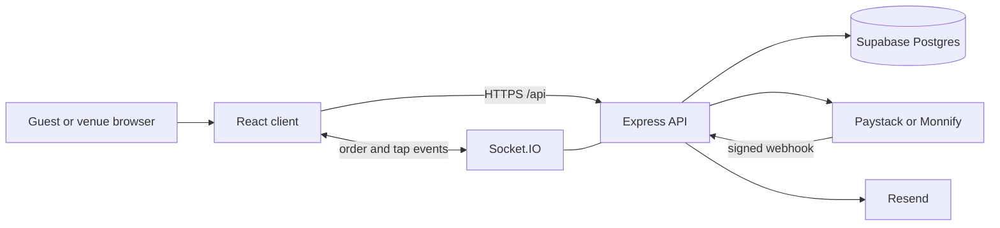

# Architecture

Guests and venue staff use the same React app. The Express server is the only component that talks to Supabase, Paystack, Monnify, and Resend.

## Processes

`server/index.js` builds the HTTP server and, when you run it directly, binds the port and starts background work. Requiring the file does not listen. That keeps tests and the Vercel entry (`api/index.js`) from opening a second server.

Background work lives in `server/jobs/scheduler.js`:

- receipt sweep, for ticket emails that did not send on the first attempt
- subscription renewal reminders
- a light Supabase keep-alive when `KEEPALIVE_ENABLED` is on

Jobs do not start if Supabase env is missing.

## Payments

Route handlers in `server/routes/payment.js` check the HTTP request and call `server/services/payments.js` to mark an order paid, enqueue the receipt, and schedule a payout. Paystack signature checks are in `server/lib/paystackWebhook.js`. Whether a webhook should settle, retry a receipt, or do nothing is decided by `server/lib/webhookSettlement.js`, and both Paystack and Monnify go through that function.

Order totals and ticket rules are built in `server/lib/orderDraft.js` before anything is inserted.

## Data

Postgres is hosted on Supabase. The server uses the service role key and does not rely on the anon key for writes. Row level security policies are in `supabase/migrations/002_row_level_security.sql`. Menu photos go in a public Storage bucket named `menu-items`.

Real-time order updates use Socket.IO. A business room only joins after a valid business JWT. On Vercel, `api/index.js` mounts the same routers with a no-op socket because serverless functions cannot hold the connection. Use the long-running server (`npm start`, or Railway via `nixpacks.toml`) when the dashboard needs live updates.

## Client

Vite dev server proxies `/api` to the API. In production, set `VITE_API_URL` to the API origin and rebuild. The API's `FRONTEND_URL` must be that site's origin or the browser will block the calls.
