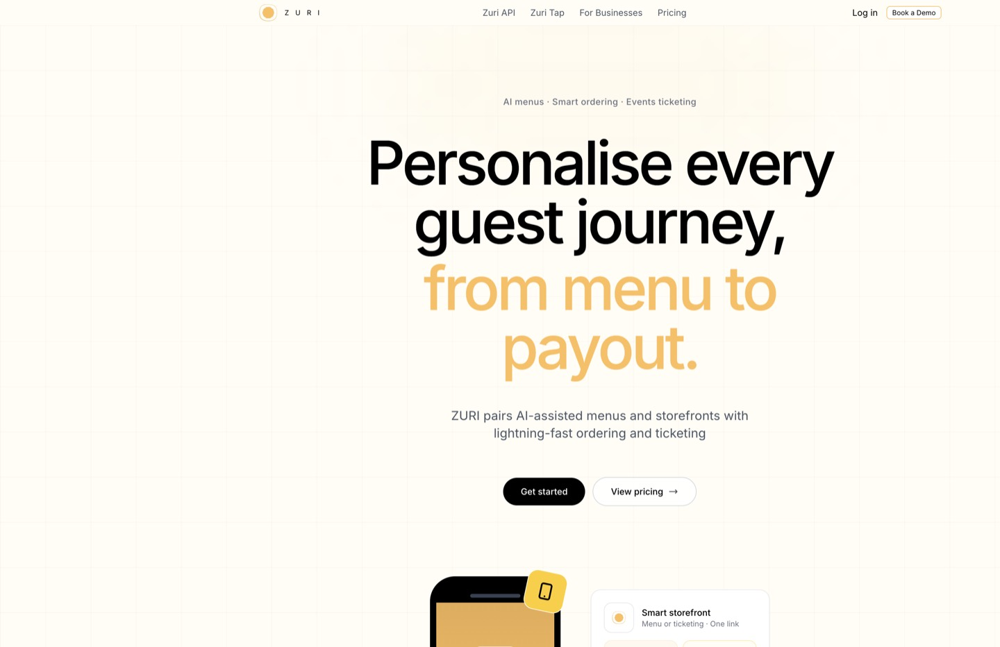
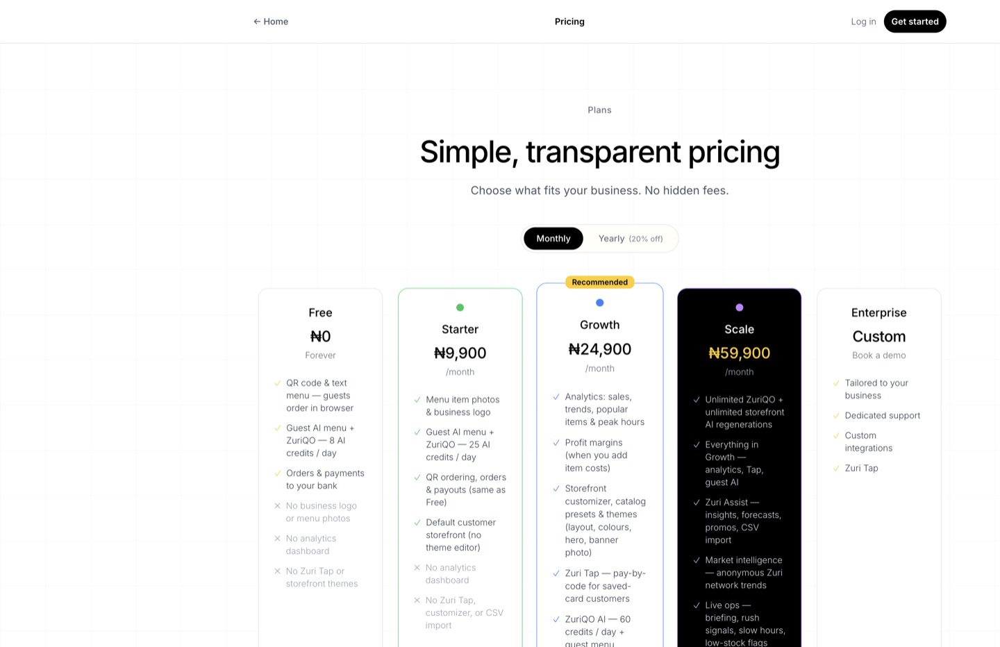
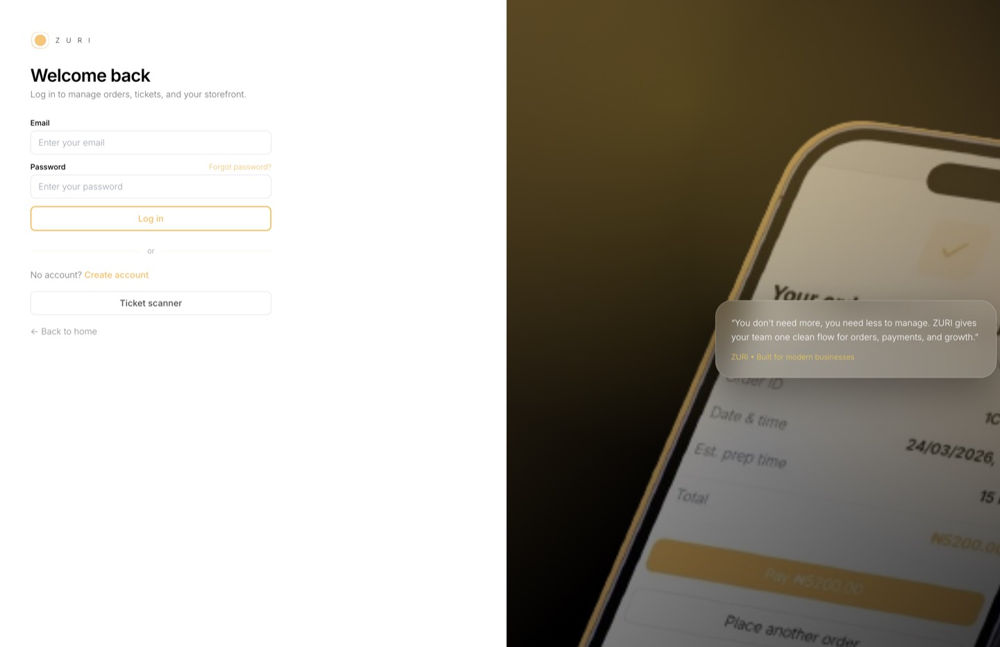
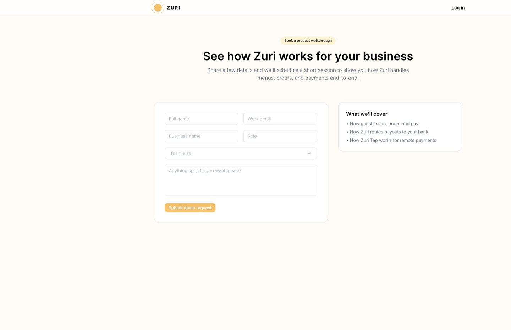

# Product demonstration

These screenshots are the local app with no venue logged in. The ordering and dashboard flows need the demo seed from the README.

The home page is the product pitch: QR ordering, payments, and the venue dashboard.

Plans are Free, Starter, Growth, and Scale. Paid plans are checked out through the same payment stack as guest orders.

Venue staff sign in here. After `supabase/seed_demo_full.sql`, the demo account is `demo@zuri.com` / `demo123`.

The demo form posts to `POST /api/contact`. Without Resend configured, the API says mail is not set up and the page falls back to `info@zuriqo.com`.

## Walkthrough with the demo seed

1. `npm run dev`, then open http://localhost:5173.
2. Log in at `/business/login` with `demo@zuri.com` / `demo123`.
3. The dashboard lists the sample menu. Open the storefront link for that business (the order page uses `/order/<business id>`).
4. Place an order as a guest. A free item is marked paid immediately. A priced item returns a pending order and `POST /api/payment/initialize` starts checkout.
5. Paystack or Monnify sends a webhook. The first success marks the order paid. A second delivery of the same event does not mark it paid again.

Without payment keys, stop after step 4. The order row is still created, and `npm test` covers the webhook rule that step 5 relies on.
